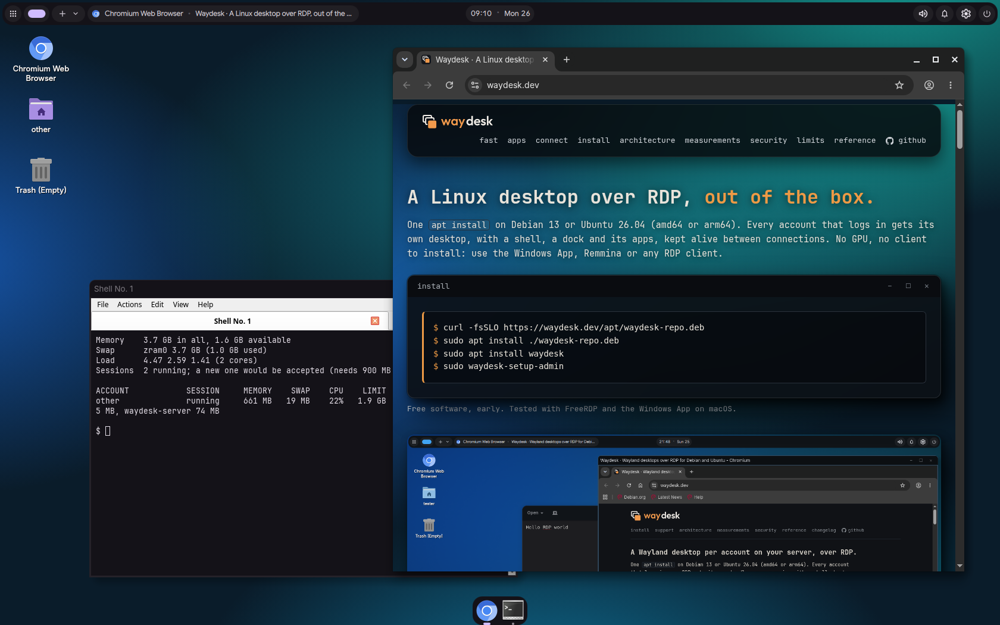

<p align="center">
  <picture>
    <source media="(prefers-color-scheme: dark)" srcset="branding/waydesk-logo-dark.svg">
    
  </picture>
</p>

<p align="center">
  <a href="https://github.com/zhoorta/waydesk/releases/latest"></a>
  
  
  <a href="https://waydesk.dev"></a>
</p>

# Waydesk: a Linux desktop over RDP, out of the box

One `apt install` on Debian 13 or Ubuntu 26.04 gives every account on the server its own desktop (sway, a shell, a dock and apps) over RDP. Sessions are kept
alive between connections, the picture is H.264 and no GPU is needed. Connect with the Windows App, Remmina or any RDP client: nothing to install on the client.

<p align="center">
  
</p>

- **One desktop per account.** Each login gets its own headless sway, sized and scaled from what the client asks for (a Retina Mac or a laptop at 200 % scaling gets a sharp picture, and the window resizes live). Reconnect and the windows are where you left them.
- **Memory is protected.** A new session is refused when the machine is full, every account has ceilings, and compressed swap absorbs spikes. A 12-vCPU, 23 GB server held 12 heavy users (Chromium, Calc and VS Code open) before it refused the 13th: [measurements and methods](https://waydesk.dev/#measurements).
- **Secure by default.** The RDP port listens on loopback only; a WireGuard VPN, a local certificate authority and an address allowlist are built in (`waydesk-admin vpn init`, `waydesk-admin access`). The daemon is unprivileged and sandboxed, and a small root helper only checks a password and starts a session. See the [threat model](docs/THREAT-MODEL.md).
- **Administration included.** `waydesk-admin` and a Users & Access panel manage accounts, limits and sessions, and a Task Manager shows what each account uses.
- **Free software.** Apache-2.0 or MIT, built on [IronRDP](https://github.com/Devolutions/IronRDP) and [sway](https://swaywm.org).

## Install

Debian 13 or Ubuntu 26.04 LTS, amd64 or arm64, as an administrator of the server:

```
curl -fsSLO https://waydesk.dev/apt/waydesk-repo.deb
sudo apt install ./waydesk-repo.deb
gpg --show-keys --with-fingerprint /usr/share/keyrings/waydesk-archive-keyring.gpg   # must be C646 72B2 5ECD 4773 196C 3958 9D8E 8874 E676 17F4
sudo apt update && sudo apt install waydesk
sudo waydesk-setup-admin      # the first administrator
waydesk-setup                 # optional: browsers, office, developer and creative apps (as the administrator account, not root)
```

The first download cannot be verified by the repository itself, so compare the fingerprint above with the one printed. The RDP port listens on `127.0.0.1:3389`:
reach it through an SSH tunnel or a VPN ([WireGuard](docs/WIREGUARD.md)), never straight from the internet. There is no default account and no default password.
Then connect an RDP client to the server (through the tunnel) with the administrator's name and password, and check the certificate fingerprint it prints.

## Status

Early. Tested with FreeRDP and the Windows App on macOS. Not independently reviewed: four internal security passes are in
[docs/SECURITY-REVIEW.md](docs/SECURITY-REVIEW.md), and the open items are in the [threat model](docs/THREAT-MODEL.md). Other distributions are not supported yet (the packages are `.deb` only).
The clipboard is text only, and there is no hardware encoding yet; the [roadmap](docs/ROADMAP.md) lists what is next. To report a vulnerability, see [SECURITY.md](SECURITY.md).

## Documentation

- [Website](https://waydesk.dev): architecture, measurements and their methods, security and a reference
- [Guide](docs/GUIDE.md): the long form of this page: server and desktop packages, memory protection, who may log in, account management, running the daemon by hand
- [Reference](docs/REFERENCE.md): packages, commands, units, ports and files
- [Access](docs/ACCESS.md) and [WireGuard](docs/WIREGUARD.md): who can reach the port
- [Measurements](docs/MEASUREMENTS.md), [Portability](docs/PORTABILITY.md), [Changelog](CHANGELOG.md)

## Names and licence

**Waydesk** is a working name; `apt install waydesk` installs everything (`waydesk-server` and `waydesk-desktop`). Waydesk builds on the sway compositor and is not part of the sway
project. No trademark or package-name clearance has been done.

Dual-licensed under either of [Apache-2.0](LICENSE-APACHE) or [MIT](LICENSE-MIT), at your option. `patches/ironrdp-server` is a modified copy of IronRDP's `ironrdp-server` crate and keeps its own licence.
The repository also ships three copyleft programs as binaries (matugen, quickshell, a patched pcmanfm-qt); their source is at <https://waydesk.dev/apt/source/>, see [the guide](docs/GUIDE.md#source-of-the-copyleft-programs).
